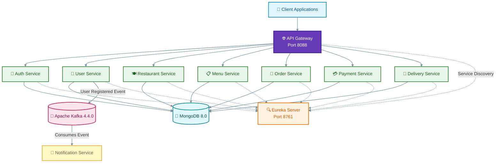

# 🍔 Food Delivery Microservices

A Java-based Food Delivery Backend built using **Spring Boot, Spring Cloud, Microservices Architecture, MongoDB, Kafka, Docker, and JWT Security**.

The project provides independent services for authentication, users, restaurants, menus, orders, payments, deliveries, and notifications.

## 🏗️ System Architecture

The following diagram illustrates the overall microservices architecture, service communication, database connectivity, and asynchronous event processing.



## 🚀 Microservices

| Service | Responsibility |
|---|---|
| Eureka Server | Service registration and discovery |
| API Gateway | Centralized routing and circuit breakers |
| Auth Service | Authentication and JWT |
| User Service | User profile management |
| Restaurant Service | Restaurant management |
| Menu Service | Menu item management |
| Order Service | Customer order management |
| Payment Service | Payment operations |
| Delivery Service | Delivery management |
| Notification Service | Kafka event consumption |

## 🛠️ Technology Stack

| Technology | Usage |
|---|---|
| Java 17 | Programming language |
| Spring Boot 3.5.7 | Backend framework |
| Spring Cloud 2025.0.0 | Microservices infrastructure |
| Spring Cloud Gateway | API routing |
| Netflix Eureka | Service discovery |
| Spring Security | Application security |
| JWT | Token-based authentication |
| MongoDB 8.0 | NoSQL database |
| Apache Kafka 4.4.0 | Event messaging |
| Resilience4j | Circuit breaker |
| Maven | Build management |
| Docker | Containerization |
| JaCoCo | Code coverage |

## 📁 Project Structure

```text
food-delivery-microservices/
│
├── common-lib/
├── eureka-server/
├── api-gateway/
├── auth-service/
├── user-service/
├── restaurant-service/
├── menu-service/
├── order-service/
├── payment-service/
├── delivery-service/
├── notification-service/
│
├── Dockerfile
├── docker-compose.yml
├── pom.xml
├── .gitignore
└── README.md
```

## ⚙️ Prerequisites

Install the following:

- JDK 17
- Maven 3.9+
- Docker Desktop / Docker Engine
- Docker Compose

## 🔐 Environment Configuration

Create a `.env` file in the project root and configure the required environment variables.

```bash
cp .env.example .env
nano .env
```


```dotenv
JWT_SECRET_KEY=YOUR_PRIVATE_JWT_SECRET
EUREKA_CLIENT_SERVICEURL_DEFAULTZONE=http://eureka-server:8761/eureka/
SPRING_KAFKA_BOOTSTRAP_SERVERS=kafka:9092
MAIL_USERNAME=YOUR_MAIL_USERNAME
MAIL_PASSWORD=YOUR_MAIL_PASSWORD
```

**Important:** Replace placeholders with your own local configuration. Never commit `.env`, passwords, JWT secrets, or private credentials to GitHub.

## 🔨 Build Project

Run from the project root:

```bash
mvn clean verify
```

This builds the Maven modules and executes the automated tests.

## 🐳 Docker Image Build

Build the service images:

```bash
docker build -t food-eureka:test --build-arg MODULE=eureka-server .
docker build -t food-gateway:test --build-arg MODULE=api-gateway .
docker build -t food-auth-service:test --build-arg MODULE=auth-service .
docker build -t food-user-service:test --build-arg MODULE=user-service .
docker build -t food-restaurant-service:test --build-arg MODULE=restaurant-service .
docker build -t food-menu-service:test --build-arg MODULE=menu-service .
docker build -t food-order-service:test --build-arg MODULE=order-service .
docker build -t food-payment-service:test --build-arg MODULE=payment-service .
docker build -t food-delivery-service:test --build-arg MODULE=delivery-service .
docker build -t food-notification-service:test --build-arg MODULE=notification-service .
```

## ▶️ Run Application

Start all containers:

```bash
docker compose up -d
```

Check container status:

```bash
docker compose ps
```

View logs:

```bash
docker compose logs -f api-gateway
```

View notification service logs:

```bash
docker compose logs -f notification-service
```

Stop application:

```bash
docker compose down
```

## 🌐 Application URLs

| Component | URL |
|---|---|
| API Gateway | http://localhost:8088 |
| Eureka Dashboard | http://localhost:8761 |

## 🔗 API Gateway Routes

| Service | Endpoint |
|---|---|
| Auth | `/api/v1/auth/**` |
| User | `/api/v1/users/**` |
| Restaurant | `/api/v1/restaurants/**` |
| Menu | `/api/v1/menu-items/**` |
| Order | `/api/orders/**` |
| Payment | `/api/payments/**` |
| Delivery | `/api/deliveries/**` |

### Example API Requests

Get restaurants:

```bash
curl -i "http://localhost:8088/api/v1/restaurants?page=0&size=10"
```

Get restaurant menu:

```bash
curl -i "http://localhost:8088/api/v1/menu-items/restaurant/RESTAURANT_ID"
```

Protected endpoints require valid JWT authentication. Unauthorized responses without a token may be expected.

## 🔄 Resilience and Event Processing

- API Gateway uses circuit breakers and a shared service-unavailable fallback.
- Menu and Order services use circuit-breaker handling for downstream service calls.
- Eureka provides service discovery.
- Kafka handles asynchronous user-registration events.
- Notification Service consumes Kafka events.

## 🧪 Testing

Run all tests:

```bash
mvn clean verify
```

Run an individual module:

```bash
mvn -pl restaurant-service clean verify
```

JaCoCo coverage reports are generated for each application module under:

`<module-name>/target/site/jacoco/index.html`

Modules with coverage reports:
- api-gateway
- auth-service
- user-service
- restaurant-service
- menu-service
- order-service
- payment-service
- delivery-service
- notification-service

## 👨‍💻 Developer

**Project:** Food Delivery Microservices

**Role:** Java Backend Developer

**Focus:** REST APIs, Microservices Architecture, Spring Boot, Security, Docker, and Event-Driven Communication.

---

⭐ If you find this project useful, consider starring the repository on GitHub.
